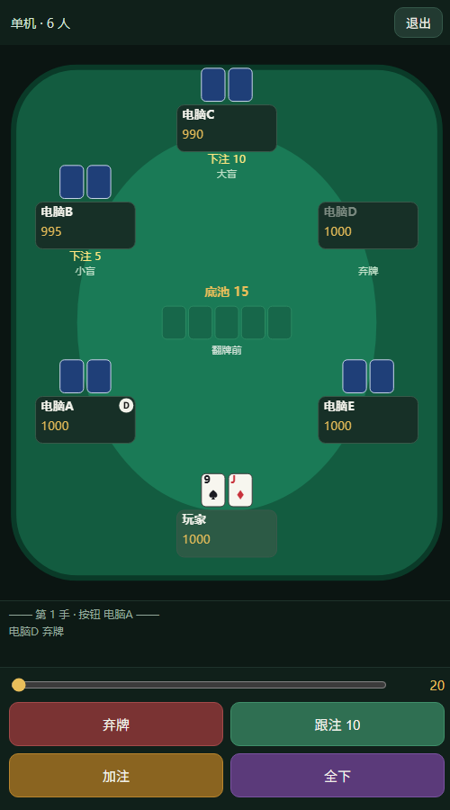

# 德州扑克 · 单机 / 好友联机

一个可以直接在手机或浏览器里玩的德州扑克小游戏：

- 单机 2~9 人，对战电脑 AI
- 好友联机：房间码 / 好友邀请，不用开服务器、不用内网穿透
- 完整规则：翻牌前 / 翻牌 / 转牌 / 河牌、盲注、加注、全下、边池、平分底池、摊牌比牌
- 账号：本地昵称 + 8 位 ID、自定义头像、好友申请与同意
- 安卓端：WebView 套壳 + 前台保活服务，断线自动重连
- 电脑端：同一套网页，浏览器直接打开



## 目录结构

```
web/                网页版（也是 APK 里的页面）
  index.html
  app.js            界面 / 联机 / 好友 / 头像
  engine.js         牌型、状态机、AI
  style.css
  mqtt.min.js       MQTT 客户端（mqtt.js，MIT）
android/            安卓工程（无 Gradle，aapt2 + javac + d8 手工构建）
  AndroidManifest.xml
  src/...           MainActivity（WebView、相册选择）、PokerService（前台保活）
  res/
  build_apk.ps1     一键构建 APK
desktop/            Python + pygame 桌面版（独立单机版）
docs/screenshots/   截图
```

## 网页版运行

```bash
cd web
python -m http.server 8080
```

浏览器打开 `http://127.0.0.1:8080`。也可以直接双击 `web/index.html`（`file://` 下 MQTT 也能用）。

> 联机依赖公共 MQTT 中继 `wss://broker.emqx.io:8084/mqtt`，需要能访问外网。

## 构建 APK

环境要求：

- JDK 17+
- Android SDK：`platforms;android-34`、`build-tools;34.0.0`
- Windows PowerShell

```powershell
$env:JAVA_HOME   = "C:\Program Files\Java\jdk-17"
$env:ANDROID_HOME = "$env:LOCALAPPDATA\Android\Sdk"
powershell -ExecutionPolicy Bypass -File .\android\build_apk.ps1
```

产物在 `dist\德州扑克.apk`。脚本会自动把 `web/` 同步进 `android/assets/`，用本地 `debug.keystore` 签名（首次运行自动生成，已 gitignore）。

APK 为调试签名，安装时系统可能提示"未知来源/风险"，选择继续安装即可。

## 联机原理

没有自建服务器，牌局跑在**房主**的设备上：

- 房主创建房间，生成 6 位房间码
- 所有人通过公共 MQTT 中继（EMQX）交换消息
- 主题：`dafeiyu/pk/v1/{房间码}/...`
- 每个玩家只订阅自己的 `state/{clientId}`，所以只能看到自己的底牌，摊牌才亮牌
- 好友系统：`dafeiyu/pk/v1/user/{uid}/...`，包含在线状态、好友申请、邀请

房主退出或断网，房间就结束；客人切后台回来会自动重新加入。

## 已知限制

- **公共中继**：消息是明文，别用来玩钱；房间码不要发公开群。
- **本地账号**：昵称/ID/头像/好友都存在本机，没有密码，换设备会生成新 ID。
- **后台**：Android 前台服务 + 唤醒锁能撑一段时间，但系统仍可能限制 WebView 定时器；正在对局时建议房主把应用留在前台。
- 好友申请依赖保留消息（retain），对方长期离线也能在下次上线看到；拒绝通知不是保留消息。

## 第三方

- [mqtt.js](https://github.com/mqttjs/MQTT.js)（MIT）用于浏览器 MQTT 连接
- 公共 MQTT 服务：[broker.emqx.io](https://www.emqx.com/)

## License

仓库暂未添加开源许可证；如需开源请自行选择（例如 MIT）。
